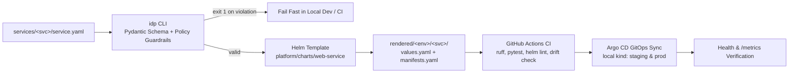

# Internal Developer Platform (Golden Path)

A declarative, zero-operator Kubernetes golden path that converts a concise developer-authored `service.yaml` into policy-validated, security-hardened Helm/Kubernetes manifests for GitOps delivery.

## Control & Data Flow



## Developer Interface vs. Platform Defaults

| Exposed in `service.yaml` (Developer Intent) | Enforced by Platform (Hidden Safe Defaults) |
| --- | --- |
| `metadata`: `name`, `owner`, `tier` (`critical` \| `standard`) | Standard `app.kubernetes.io/*` + `idp.local/*` ownership labels |
| `runtime`: `image`, immutable `tag` (semver or `sha256:`), non-privileged `port` (`1024–65535`), `healthPath` (readiness, default `/healthz`), `livenessPath` (startup + liveness, default `/livez`), `metricsPath` | `runAsNonRoot: true`, `runAsUser: 10001`, `readOnlyRootFilesystem: true`, `allowPrivilegeEscalation: false`, `capabilities.drop: [ALL]`, `seccompProfile: RuntimeDefault`, `automountServiceAccountToken: false`; split readiness (`/healthz`) vs. startup/liveness (`/livez`) probes |
| `sizing`: `profile` (`small` \| `medium` \| `large`), `minReplicas`, `maxReplicas`, `targetCPU` (`50–90`) | Deterministic CPU/memory requests & limits; `RollingUpdate` with `maxUnavailable: 0`; `PodDisruptionBudget` (`minAvailable: 1`) when `minReplicas >= 2`; `HPA` with `scaleDown.stabilizationWindowSeconds: 300` |
| `env` (non-secret key/value pairs) + `secretRefs` (K8s Secret names) | Blocks secret-like keys (`PASSWORD`, `SECRET`, `TOKEN`, `API_KEY`, `PRIVATE_KEY`, `AWS_SECRET`) and credential patterns in `env`; mounts `secretRefs` via `envFrom` |
| `environments.staging` / `environments.prod` overrides | `prod` enforces `minReplicas >= 2` (which also enables automatic `PodDisruptionBudget` generation) |

### Deterministic Sizing Profiles

| Profile | Requests (CPU / Mem) | Limits (CPU / Mem) |
| --- | --- | --- |
| `small` | `100m` / `128Mi` | `250m` / `256Mi` |
| `medium` | `250m` / `256Mi` | `500m` / `512Mi` |
| `large` | `500m` / `512Mi` | `1000m` / `1Gi` |

## Repository Structure

```text
apps/
  payments-api/           # Minimal stdlib HTTP service (/, /livez, /healthz, /metrics) + non-root Dockerfile
platform/
  cli/                    # Python 3.11+ idp CLI (schema, policy, renderer, pytest)
  charts/web-service/     # Standardized golden-path Helm chart
  kind/                   # Local kind cluster config, bootstrap.sh, teardown.sh
gitops/
  argocd/                 # Restricted-PSS namespaces and GitOps ApplicationSet
services/
  payments-api/           # Sample golden-path service.yaml (staging + prod)
rendered/
  staging/payments-api/   # Deterministic rendered Helm values & K8s manifests
  prod/payments-api/      # Deterministic rendered Helm values & K8s manifests
experiments/
  01-config-validation/   # Guardrail proof + invalid fixtures
  02-deployment-health/   # Healthy vs. failed rollout experiment & runner script
```

## Quick Start

```bash
# Install CLI + dev tools
make sync

# Run full validation, lint, test, helm lint, and render drift check
make check

# Inspect CLI output on valid and invalid configs
uv run --project platform/cli idp validate services/payments-api/service.yaml --env all
uv run --project platform/cli idp validate experiments/01-config-validation/invalid-latest-tag.yaml --format json
```

## Controlled Platform Experiments

| # | Experiment | Status | Summary |
| --- | --- | --- | --- |
| 01 | [Config Validation & Policy Guardrails](experiments/01-config-validation/README.md) | **Complete** | Proves valid config passes (`exit 0`), 4 invalid fixtures fail with exact violation codes (`exit 1`), and parse errors isolate to `exit 2`. |
| 02 | [Failed Rollouts Behind a Service (Readiness vs. Liveness)](experiments/02-deployment-health/README.md) | **Complete** | In-cluster traffic through the Service stayed at 625/625 OK during readiness-failure and bad-image rollouts on `kind`; the failing pod stayed not-ready with 0 restarts. Pointing liveness at `/healthz` instead caused 2 restarts in 90 s. |
| 03 | Fixed Replicas vs. HPA Under Synthetic Load | Planned | Compare fixed replica count against HPA scaling and stabilization window under synthetic CPU load. |
| 04 | Release Promotion vs. GitOps Rollback | Planned | Promote `v1 -> broken v2`, revert in Git, and measure Argo CD automatic recovery time. |

## Architecture Tradeoffs

- **Render-time CLI over Kubernetes Operator**: Rendering manifests into `rendered/` produces auditable Git diffs, uses standard Helm/Kubernetes primitives, and avoids custom controller operational blast radius.
- **No Backstage clone / No Service Mesh**: Focuses strictly on the declarative contract, policy boundary, and GitOps control loop rather than UI scaffolding or L7 proxy overhead.
- **Staging vs. Prod Parity**: A single `service.yaml` defines shared runtime intent while environment overlays control sizing and non-secret config, keeping environment drift explicit and reviewable.

## Security Model & Limitations

- **Secrets Boundary**: Secret values never enter Git; only Kubernetes `Secret` object references (`secretRefs`) are declared. Secret provisioning happens out-of-band in the cluster (see `SECURITY.md`).
- **Known Limitations**:
  - Current milestone validates/renders deterministic manifests, enforces `restricted` PSS on local `kind`, and proves Experiments 01–02; Experiments 03 (HPA under load) and 04 (GitOps rollback) are scheduled next.
  - No custom escape-hatch Helm override block is exposed yet to keep security defaults strictly non-overridable.
  - CPU-only HPA targeting (`targetCPU`); custom/RPS metrics require a metrics adapter outside this baseline scope.
