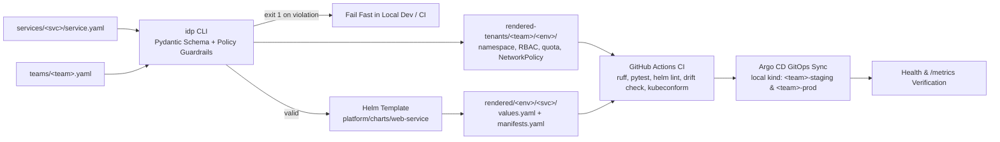

# Internal Developer Platform (Golden Path)

A declarative, zero-operator Kubernetes golden path that converts a concise developer-authored `service.yaml` into policy-validated, security-hardened Helm/Kubernetes manifests for GitOps delivery.

## Control & Data Flow



## Developer Interface vs. Platform Defaults

| Exposed in `service.yaml` (Developer Intent) | Enforced by Platform (Hidden Safe Defaults) |
| --- | --- |
| `metadata`: `name`, `owner`, `tier` (`critical` \| `standard`) | Standard `app.kubernetes.io/*` + `idp.local/*` ownership labels |
| `runtime`: `image`, immutable `tag` (semver or `sha256:`), non-privileged `port` (`1024–65535`), `healthPath` (readiness, default `/healthz`), `livenessPath` (startup + liveness, default `/livez`), `metricsPath` | `runAsNonRoot: true`, `runAsUser: 10001`, `readOnlyRootFilesystem: true`, `allowPrivilegeEscalation: false`, `capabilities.drop: [ALL]`, `seccompProfile: RuntimeDefault`, `automountServiceAccountToken: false`; split readiness (`/healthz`) vs. startup/liveness (`/livez`) probes |
| `sizing`: `profile` (`small` \| `medium` \| `large`), `minReplicas`, `maxReplicas`, `targetCPU` (`50–90`) | Deterministic CPU/memory requests & limits; `RollingUpdate` with `maxUnavailable: 0`; `PodDisruptionBudget` (`minAvailable: 1`) when `minReplicas >= 2`; `HPA` with `scaleDown.stabilizationWindowSeconds: 300` |
| `env` (non-secret key/value pairs) + `secretRefs` (K8s Secret names) | Blocks secret-like keys (`PASSWORD`, `SECRET`, `TOKEN`, `API_KEY`, `PRIVATE_KEY`, `AWS_SECRET`) and credential patterns in `env`; mounts `secretRefs` via `envFrom` |
| `environments.staging` / `environments.prod` overrides | `prod` enforces `minReplicas >= 2` (which also enables automatic `PodDisruptionBudget` generation) |
| `metadata.owner` (must match a `teams/<team>.yaml`) | Deploys only into the owner's tenant namespace `<team>-<env>` (`IDP_OWNER_UNKNOWN` otherwise). Render fails with `IDP_QUOTA_EXCEEDED` if `maxReplicas` + 1 rolling-update surge pod does not fit the team's ResourceQuota |

## Team Tenancy

Each team declares itself once in `teams/<team>.yaml` (identity group, per-environment quota, and which other teams may call it). `idp render-tenants` turns that into one namespace per environment, `<team>-<env>`, containing:

| Object | Effect |
| --- | --- |
| Namespace labels | Pod Security Admission `restricted` (enforce, warn, audit); `idp.local/team`, `idp.local/environment` |
| RoleBinding `team-edit` | Built-in `edit` ClusterRole for the team's group, in its own namespaces only |
| ResourceQuota `team-quota` | CPU/memory requests and limits, pod count; `services.loadbalancers: 0`, `services.nodeports: 0` |
| LimitRange `team-defaults` | Default container requests/limits (small profile) for pods that do not set them |
| NetworkPolicy `default-deny-ingress` + `allow-same-namespace` | Pods accept traffic only from their own namespace |
| NetworkPolicy `allow-from-peer-teams` | Only when `allowIngressFrom` is set: ingress from the listed teams' namespaces in the same environment |

Argo CD Application `idp-tenants` syncs `rendered-tenants/` with `prune: false`, so deleting a team file never deletes a namespace that still holds workloads.

### Deterministic Sizing Profiles

| Profile | Requests (CPU / Mem) | Limits (CPU / Mem) |
| --- | --- | --- |
| `small` | `100m` / `128Mi` | `250m` / `256Mi` |
| `medium` | `250m` / `256Mi` | `500m` / `512Mi` |
| `large` | `500m` / `512Mi` | `1000m` / `1Gi` |

## Repository Structure

```text
apps/
  payments-api/           # Minimal stdlib HTTP service (/, /livez, /healthz, /work, /metrics) + non-root Dockerfile
platform/
  cli/                    # Python 3.11+ idp CLI (schema, policy, renderer, pytest)
  charts/web-service/     # Standardized golden-path Helm chart
  kind/                   # Local kind cluster config, bootstrap.sh, install-metrics-server.sh, teardown.sh
gitops/
  argocd/                 # Tenants Application, annotation-tracking ConfigMap, and GitOps ApplicationSet
teams/                    # TeamSpec per team: group, quota per environment, allowed callers
services/
  payments-api/           # Golden-path service.yaml owned by payments-team
  ledger-api/             # Golden-path service.yaml owned by ledger-team
rendered/
  <env>/<service>/        # Deterministic rendered Helm values & K8s manifests
rendered-tenants/
  <team>/<env>/           # Tenant namespace bundle (namespace, RBAC, quota, LimitRange, NetworkPolicy)
experiments/
  01-config-validation/   # Guardrail proof + invalid fixtures
  02-deployment-health/   # Healthy vs. failed rollout experiment & runner script
  03-fixed-replicas-vs-hpa/ # Open-loop load client, runner, raw results
  04-gitops-revert-rollback/ # Live Argo CD selfHeal vs. git revert rollback experiment & results
```

## Quick Start

```bash
# Install CLI + dev tools
make sync

# Run full validation, lint, test, helm lint, render drift check (services and tenants), and schema check
# (schema check needs kubeconform v0.8.0 on PATH; CI installs it checksum-verified)
make check

# Inspect CLI output on valid and invalid configs
uv run --project platform/cli idp validate services/payments-api/service.yaml --env all
uv run --project platform/cli idp validate experiments/01-config-validation/invalid-latest-tag.yaml --format json
```

## Controlled Platform Experiments

| # | Experiment | Status | Summary |
| --- | --- | --- | --- |
| 01 | [Config Validation & Policy Guardrails](experiments/01-config-validation/README.md) | **Complete** | Proves valid config passes (`exit 0`), 4 invalid fixtures fail with exact violation codes (`exit 1`), and parse errors isolate to `exit 2`. |
| 02 | [Failed Rollouts Behind a Service (Readiness vs. Liveness)](experiments/02-deployment-health/README.md) | **Complete** | In-cluster traffic through the Service stayed at 625/625 OK during readiness-failure and bad-image rollouts on `kind`; the failing pod stayed not-ready with 0 restarts. Pointing liveness at `/healthz` instead caused 2 restarts in 90 s. |
| 03 | [Fixed Replicas vs. HPA Under Open-Loop CPU Load](experiments/03-fixed-replicas-vs-hpa/README.md) | **Complete** | At 60 req/s (2 replicas cleanly serve ~40), fixed replicas failed 23–25% of requests across 3 runs and the pods took liveness restarts. The HPA scaled to 6 within 14–29 s and errors fell to 1.2–2.7%, all within the first 40 s. Scale-down came ~290 s after CPU dropped. |
| 04 | [Imperative Rollback vs. GitOps `git revert` Under Argo CD `selfHeal`](experiments/04-gitops-revert-rollback/README.md) | **Complete** | Live Argo CD `v2.14.2` on `kind`: `kubectl rollout undo` was reverted by `selfHeal` in **1 s** (both trials), while `git revert` reached `Synced / Healthy` in **173 s** under default 3-min polling and **5 s** with `refresh=hard`; in-cluster availability stayed 100% (2700/2700 OK). |

## Architecture Tradeoffs

- **Render-time CLI over Kubernetes Operator**: Rendering manifests into `rendered/` produces auditable Git diffs, uses standard Helm/Kubernetes primitives, and avoids custom controller operational blast radius.
- **No Backstage clone / No Service Mesh**: Focuses strictly on the declarative contract, policy boundary, and GitOps control loop rather than UI scaffolding or L7 proxy overhead.
- **Staging vs. Prod Parity**: A single `service.yaml` defines shared runtime intent while environment overlays control sizing and non-secret config, keeping environment drift explicit and reviewable.

## Security Model & Limitations

- **Secrets Boundary**: Secret values never enter Git; only Kubernetes `Secret` object references (`secretRefs`) are declared. Secret provisioning happens out-of-band in the cluster (see `SECURITY.md`).
- **Known Limitations**:
  - Current milestone validates/renders deterministic manifests, enforces `restricted` PSS on local `kind`, reconciles live via Argo CD `v2.14.2`, and proves Experiments 01–04.
  - No custom escape-hatch Helm override block is exposed yet to keep security defaults strictly non-overridable.
  - CPU-only HPA targeting (`targetCPU`); custom/RPS metrics require a metrics adapter outside this baseline scope.
